# Viberglass

[](LICENSE)
[](https://nodejs.org/)
[](https://www.typescriptlang.org/)
[](https://github.com/Ilities/viberglass/issues)

An open-source, self-hosted workspace where people and coding agents work on the same tasks together. Viberglass is for software companies: product, design, QA, support and engineering bring the work, the agents do it, and everyone sees and shapes it in one shared thread, from the first question to the merged pull request.

Coding agents are good at writing code. They're bad at knowing what your company actually wants. In Viberglass, the people who know what's wanted stay in the conversation: they're asked when the agent is unsure, they review its plan before any code is written, and they decide when it's done. Nobody needs repository access or a dev environment to take part.

[Documentation](docs/) | [Architecture](docs/ARCHITECTURE.md) | [Contributing](CONTRIBUTING.md) | [Security](SECURITY.md)

[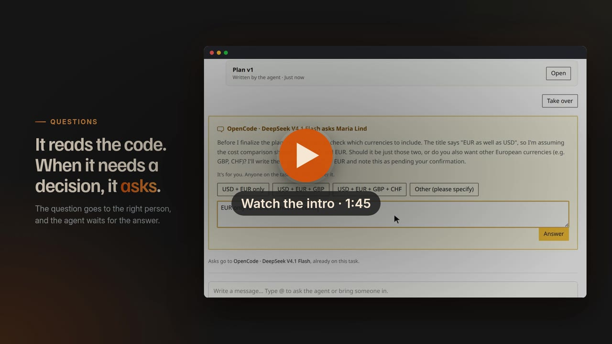](https://viberglass.io/#video)

## How a task works

1. Someone asks for something. A PM, a support lead or an engineer creates a task in a space, from the web, Slack (`/viberglass`) or an issue tracker. They own it, and can bring in reviewers and watchers.
2. The agent writes a plan. It reads the code and writes one document: what it found and what it would change. When it's missing something, it asks the right person in the thread and waits for their answer.
3. The team agrees on it. Reviewers comment on lines of the plan, suggest edits, @mention a designer or an engineer, and ask the agent to revise. Everyone sees the same plan, the same comments and the same history.
4. The agent builds it and opens a GitHub pull request for engineering's usual review. Large plans can be built in parts, with a PR per part.
5. The PR is merged and the task closes. Anyone can ask for another round on the same task; it keeps its conversation and its branch.

<table>
<tr>
<td width="50%"><picture><source media="(prefers-color-scheme: dark)" srcset="docs/guide/images/agent-question-dark.png">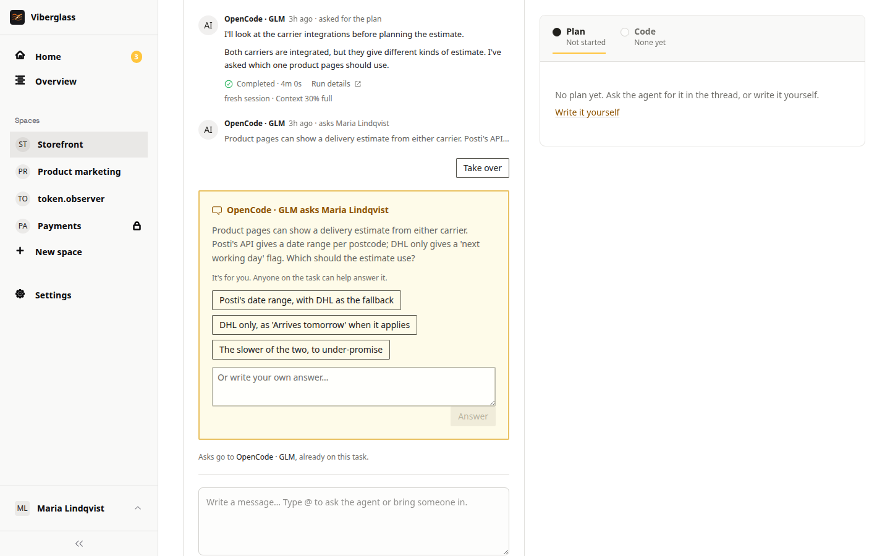</picture></td>
<td width="50%"><picture><source media="(prefers-color-scheme: dark)" srcset="docs/guide/images/plan-comment-dark.png">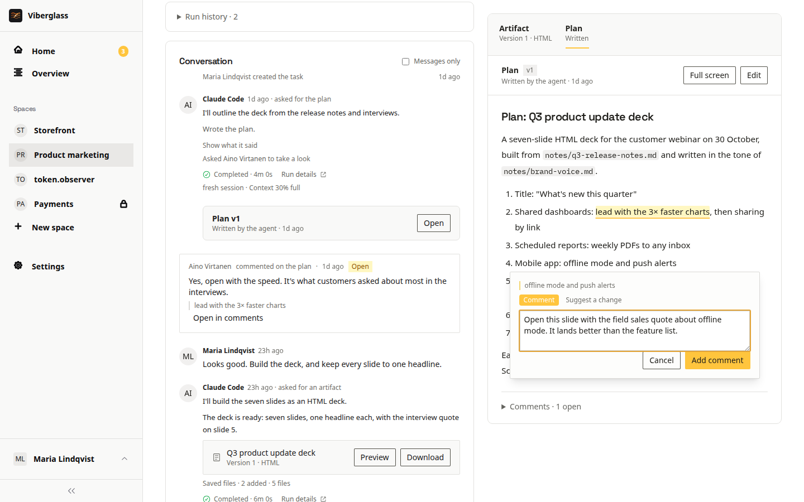</picture></td>
</tr>
<tr>
<td>The agent asks the person it needs and waits for the answer.</td>
<td>Reviewers comment on lines of the plan or suggest edits.</td>
</tr>
</table>
<table>
<tr>
<td width="50%"><picture><source media="(prefers-color-scheme: dark)" srcset="docs/guide/images/plan-version-compare-dark.png">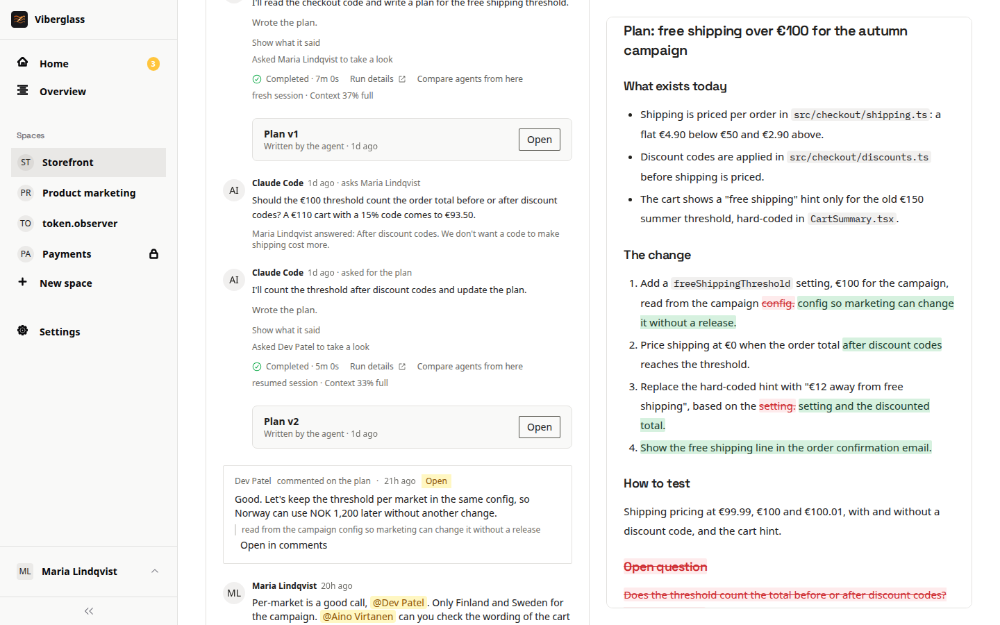</picture></td>
<td width="50%"><picture><source media="(prefers-color-scheme: dark)" srcset="docs/guide/images/task-thread-dark.png">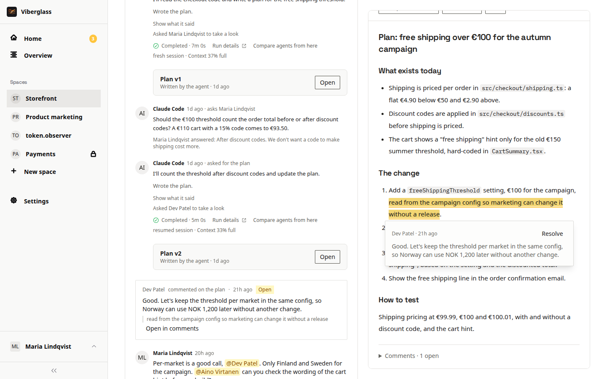</picture></td>
</tr>
<tr>
<td>Every plan version is kept and can be compared word by word.</td>
<td>The thread and the plan side by side, for everyone on the task.</td>
</tr>
</table>

An engineer can step in at any point: pause the agent, take over its branch locally with `viberglass checkout` (`npm install -g viberglass`), and hand it back.

<picture><source media="(prefers-color-scheme: dark)" srcset="docs/guide/images/taken-over-dark.png">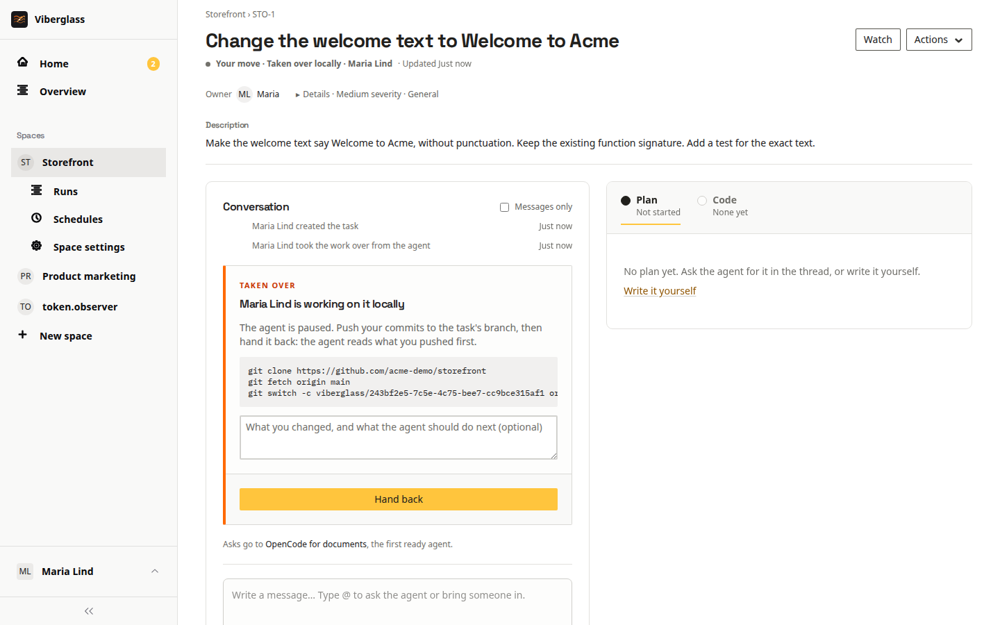</picture>

## Spaces without a repository

For work that isn't code, a space can be backed by Files instead of a Git repository: a shared set of files the space's tasks and people work on, kept between runs in S3-compatible storage. People can upload files and edit Markdown and text in the app and agents restore the files at the start of each run and save them at the end.

Files backed spaces support "artifacts" where an agent makes a deliverable such as a document, a report or an HTML presentation. These artifacts are versioned by Viberglass. Web pages, presentations, images and PDFs preview in the app from a separate, sandboxed address. These artifacts can be iterated on and asking an agent for a new revision makes the next version. A Files task is finished when someone marks it done.

<table>
<tr>
<td width="50%"><picture><source media="(prefers-color-scheme: dark)" srcset="docs/guide/images/files-editor-dark.png">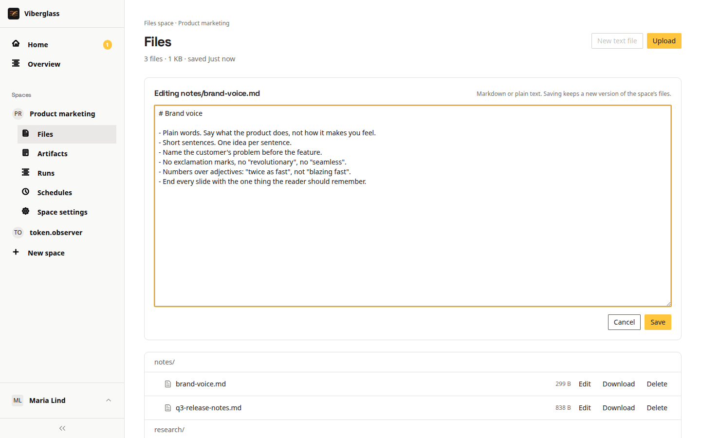</picture></td>
<td width="50%"><picture><source media="(prefers-color-scheme: dark)" srcset="docs/guide/images/artifact-preview-dark.png">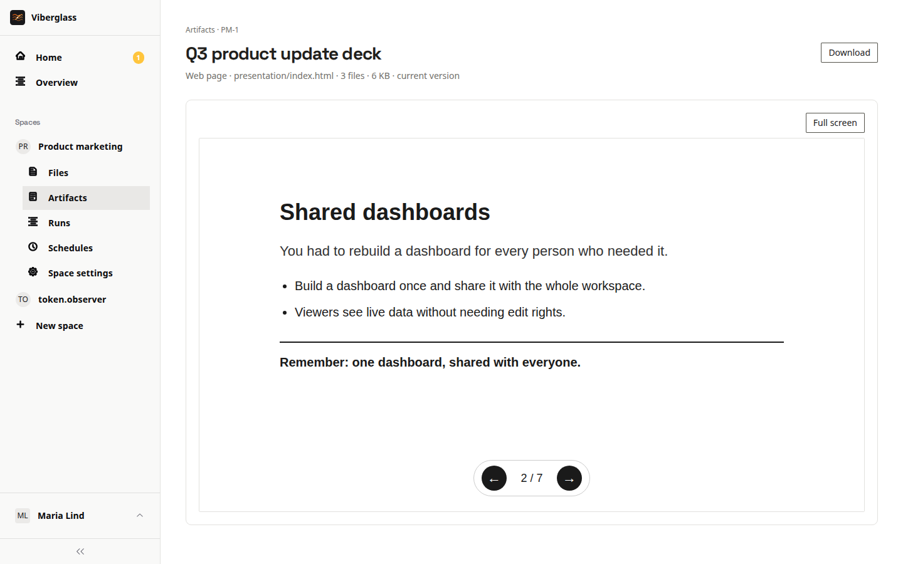</picture></td>
</tr>
<tr>
<td>A Files space: upload files and edit Markdown and text in the app.</td>
<td>A presentation the agent made, previewed in the app.</td>
</tr>
</table>

## Features

- One thread per task: people's messages, the agent's questions, plan revisions, comments, runs and PRs, in order, for everyone on the task.
- Large plans can be built in parts, a pull request per part, with ways around the order. Add a part to the open pull request, mark a part done or skip it, or build a stopped part again.
- Files spaces for documents, presentations and other artifacts, with versions and previews.
- Issue trackers as linked threads: a new issue in GitHub Issues, Jira or Shortcut becomes a task, comments flow both ways, and closing the issue finishes the task.
- Home shows whose move it is: a question from the agent, a review request, a mention, a failed run. Notifications reach you in Slack or by email.
- Roles that fit a company: members, guests and read-only viewers; open or private spaces; owners, reviewers and watchers per task. Not everyone who can comment can ask for code.
- Slack as a front door: start tasks, answer the agent's questions, discuss the plan and start the build from a Slack thread that stays in step with the task.
- Bring your own agent and model: eight coding agent harnesses side by side, with provider keys, coding plans, or any OpenAI- or Anthropic-compatible endpoint.
- Runs you can inspect: what the agent thought and did, its tool calls, the prompt it got, the worker log, and cost and token usage where the harness reports them.
- Workspace controls: shared secrets, MCP servers and skills for agents, agent instructions per space, API tokens and an audit log.
- Schedules for recurring agent work.

<table>
<tr>
<td width="50%"><picture><source media="(prefers-color-scheme: dark)" srcset="docs/guide/images/home-needs-you-dark.png">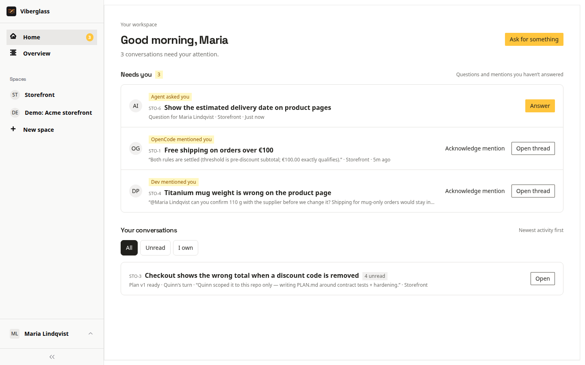</picture></td>
<td width="50%"><picture><source media="(prefers-color-scheme: dark)" srcset="docs/guide/images/run-details-dark.png">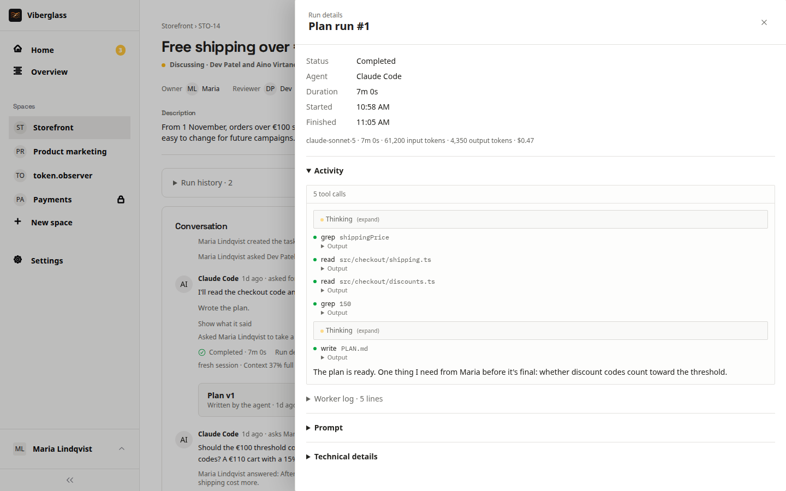</picture></td>
</tr>
<tr>
<td>Home lists what needs you: the agent's questions, review requests and mentions.</td>
<td>Run details: what the agent did, its tool calls, and cost and tokens where reported.</td>
</tr>
</table>

## Agents and models

| Harness                                                       | Models                                                            |
|---------------------------------------------------------------|-------------------------------------------------------------------|
| [Claude Code](https://docs.anthropic.com/en/docs/claude-code) | Anthropic                                                         |
| [OpenAI Codex](https://github.com/openai/codex)               | OpenAI, including ChatGPT subscription sign-in                    |
| [Google Antigravity](https://antigravity.google)              | Google                                                            |
| [Qwen Code](https://github.com/QwenLM/qwen-code)              | Alibaba                                                           |
| [Mistral Vibe](https://github.com/mistralai/mistral-vibe)     | Mistral                                                           |
| [Kimi Code](https://github.com/MoonshotAI/kimi-code)          | Moonshot                                                          |
| [OpenCode](https://github.com/opencode-ai/opencode)           | OpenCode Go, OpenRouter, DeepSeek, xAI, Groq and custom endpoints |
| [Pi](https://pi.dev)                                          | Many providers and custom endpoints                               |

<p align="center"><picture><source media="(prefers-color-scheme: dark)" srcset="docs/guide/images/agents-and-runners-dark.png">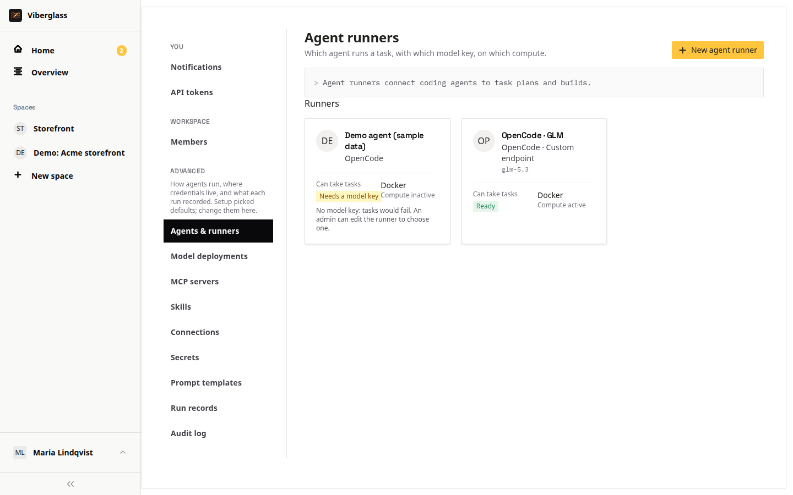</picture></p>

Custom harnesses can be introduced using the agent plugin system.
Custom model endpoints: add a URL, an API format and a key in the runner form, and every agent can use it. This covers hosted open-weight models and anything you serve yourself.

Model deployments: Viberglass can create a GPU container on [Verda](https://verda.com) running vLLM, scale it to zero when idle and wake it when a run needs it.

## Integrations

|                   |                                                 |
|-------------------|-------------------------------------------------|
| Pull requests     | GitHub                                          |
| Task sources      | GitHub Issues, Jira, Shortcut, custom webhooks  |
| Chat              | Slack                                           |
| Compute           | Docker, Kubernetes, AWS ECS Fargate, AWS Lambda |

---

## Quick start

Requires Docker Engine 20.10+ and Docker Compose v2.

```bash
git clone https://github.com/Ilities/viberglass.git
cd viberglass
docker compose up -d
```

This pulls the published images, so nothing is built. Open http://localhost:3000. The first visit creates the administrator account, then setup walks you through:

1. A model key: pick a provider and paste a key, or point at a custom endpoint.
2. The space's backing: a Git repository, with a GitHub repository and a fine-grained token that can push a branch and open a pull request (setup links to GitHub's token form with the permissions filled in), or Files, for documents and presentations.
3. A name for the space.
4. A default agent, created for you and run on your local Docker using the published worker images.
5. A first task.

There's also an "Explore a demo workspace" option on setup's first screen, with sample tasks and no keys needed.

> This compose file is for trying Viberglass on your own machine. It uses fixed database and encryption keys and only listens on this machine. For a shared installation, use [one server](#one-server), [Kubernetes](#kubernetes) or [AWS](#aws).

The backend runs database migrations on startup. To upgrade, run `docker compose pull` and `docker compose up -d`. Ports, email and other options are in [Install with Docker](docs/guide/admin/install-docker.md).

---

## Configuration

With compose, the backend's environment is set in the compose file, and optional settings go in a `.env` file in the repository root. Running the backend outside compose, it reads `apps/platform-backend/.env` (start from `.env.example`).

| Variable                                                  | Description                                                                             |
|-----------------------------------------------------------|-----------------------------------------------------------------------------------------|
| `DB_HOST`, `DB_PORT`, `DB_NAME`, `DB_USER`, `DB_PASSWORD` | PostgreSQL connection                                                                   |
| `SECRETS_ENCRYPTION_KEY`                                  | Encrypts stored credentials at rest                                                     |
| `WEBHOOK_SECRET_ENCRYPTION_KEY`                           | Encrypts webhook secrets                                                                |
| `PORT`                                                    | Backend port (default: `8888`)                                                          |
| `PLATFORM_FRONTEND_URL`                                   | The app's address, for links in Slack and email                                         |
| `EMAIL_FROM` + `SMTP_URL` (or `EMAIL_PROVIDER=ses`)       | Email for invites and notifications; off when unset                                     |
| `VIBERATOR_WORKER_REGISTRY`                               | Where worker images are pulled from (default `ghcr.io/ilities`)                         |
| `VIBERATOR_WORKER_IMAGE_TAG`                              | Tag of the worker images (default `latest`); a release tag or commit sha pins them      |
| `VIBERATOR_WORKER_NETWORK`                                | Docker network agent containers join when their runner sets none (default `bridge`)     |
| `VIBERGLASS_DATA_DIR`                                     | Where compose keeps task media and saved agent conversations (default `~/.viberglass`)  |
| `S3_ENDPOINT`, `S3_BUCKET` and the other `S3_*` settings  | S3-compatible storage for Files spaces, artifacts and media; the local compose files run MinIO |
| `PREVIEW_PORT`, `PREVIEW_PUBLIC_URL`                      | The separate address artifact previews are served from                                  |

Agent credentials are stored as workspace secrets (encrypted in the database, or in AWS SSM) and attached to runners in Settings → Agents. See [portable storage and credentials](docs/portable-storage-and-credentials.md).

---

## Deployment

### One server

[`docker-compose.prod.yml`](docker-compose.prod.yml) runs the published images on one Linux server, with the database password and encryption keys from `.env` and optional HTTPS through Caddy:

```bash
cp .env.production.example .env   # fill in the address, password and keys
docker compose -f docker-compose.prod.yml --profile https up -d
```

The steps, backups and upgrades are in [Install with Docker](docs/guide/admin/install-docker.md#on-a-server).

### Kubernetes

A Helm chart in [`infra/kubernetes/chart`](infra/kubernetes/chart) installs the backend, frontend and migrations; each agent run is a Kubernetes Job. Bring PostgreSQL, S3-compatible storage, an ingress and TLS, or use the bundled PostgreSQL and MinIO for a local cluster:

```bash
python3 infra/kubernetes/scripts/local.py
```

- [Local Kubernetes](docs/local-kubernetes.md): prerequisites, port forwards and a full-platform smoke test.
- [Install on your Kubernetes cluster](docs/guide/admin/install-kubernetes.md): step-by-step setup, Secrets, production values, TLS, installation and your first task.
- [Kubernetes operations](docs/kubernetes-deployment.md): upgrades, backups, diagnostics and cleanup.
- [OVHcloud plan](docs/kubernetes-ovh-deployment-plan.md): the managed-cluster target we're validating against.

### AWS

Three Pulumi stacks in [`infra/`](infra/README.md), deployed in order:

```bash
./infra/setup-pulumi-state.sh
pulumi login s3://viberglass-pulumi-state

cd infra/base && npm install && pulumi stack select dev && pulumi up       # VPC, KMS, logging
cd infra/workers && npm install && pulumi stack select dev && pulumi up    # Lambda and ECS workers
cd infra/platform && npm install && pulumi stack select dev && pulumi up   # ECS backend, RDS, S3, Amplify frontend
```

Runners on ECS or Lambda are created under Settings → Agents; the platform creates the task definition or function, with networking from the stack outputs.

### Worker images

Every agent runs in a worker image: a shared base plus one harness.

- Docker, Kubernetes and ECS use the public images on GHCR (`ghcr.io/ilities/viberator-worker-<agent>`, `linux/amd64` and `linux/arm64`), published by `publish-worker-images` on pushes to `main` and on releases, tagged `latest`, the commit sha and the release tag. The backend and frontend images (`viberglass-backend`, `viberglass-frontend`) are published the same way by `publish-platform-images`. Set `VIBERATOR_WORKER_REGISTRY` empty to use images you built locally, and `VIBERATOR_WORKER_IMAGE_TAG` to pin a tag.
- Lambda pulls from ECR. The `deploy-viberators` workflow pushes the Lambda image there on pushes to `main`, tagged `latest` and the commit sha.
- On AWS, ECS runners can pull from your own ECR instead: set `viberglass:workerImageRegistry: ecr` (and optionally `viberglass:workerImageTag`) in the platform stack, push the harness images, then `pulumi up` in `infra/platform` and deploy the backend. Push them with the `deploy-viberators` workflow (harness `all`) or by hand:

```bash
./infra/workers/scripts/setup-harness-images.sh dev multi-agent   # one image with every harness
./infra/workers/scripts/setup-harness-images.sh prod all          # every image
```

### Database migrations

The backend migrates on startup (on Kubernetes, a migration Job runs on each Helm revision). To run them yourself:

```bash
npm run platform-backend:migrate   # against the database in DB_* or DATABASE_URL
```

Check that a database backup exists before migrating production. [Database migrations](docs/operations/database-migrations.md) covers running them against AWS, safety rules and rollback.

---

## Security model

Agents run code from your repositories with your credentials, so it matters where those go.

- Each run gets its own container (or Kubernetes Job, ECS task or Lambda invocation), started for that run and removed after it.
- Credentials are stored encrypted (AES-256-GCM in PostgreSQL, or AWS SSM) and only the secrets bound to a runner reach its runs. Kubernetes workers fetch them at start from the backend with a token scoped to the run. They are not written into the Job spec.
- The agent doesn't see worker credentials. Worker-only credentials, such as a ChatGPT sign-in, are kept out of the agent's environment. Workers handle integration communication towards GitHub etc.

Report vulnerabilities as described in [SECURITY.md](SECURITY.md), not in public issues.

---

## Development

[Local development](docs/local-development.md) and [TESTING.md](TESTING.md) cover the dev stack and test suites. In short:

```bash
npm ci && npm run backend:build-deps                                       # once, and after changing a package
docker compose -f docker-compose.dev.yml up -d                             # dev servers with hot reload
(cd apps/platform-backend && npx jest --maxWorkers=2 src/__tests__/unit)   # backend unit tests
npm run test:e2e                                                           # smoke suite, starts its own stack
```

## Community

- [GitHub Issues](https://github.com/Ilities/viberglass/issues): bug reports and feature requests
- [GitHub Discussions](https://github.com/Ilities/viberglass/discussions): questions and ideas
- [Contributing guide](CONTRIBUTING.md)

## License

Viberglass is licensed under the [GNU Affero General Public License v3.0](LICENSE). You can use, modify and self-host it freely. If you modify it and let people use it over a network, you must offer them the source of your modified version under the same license.
