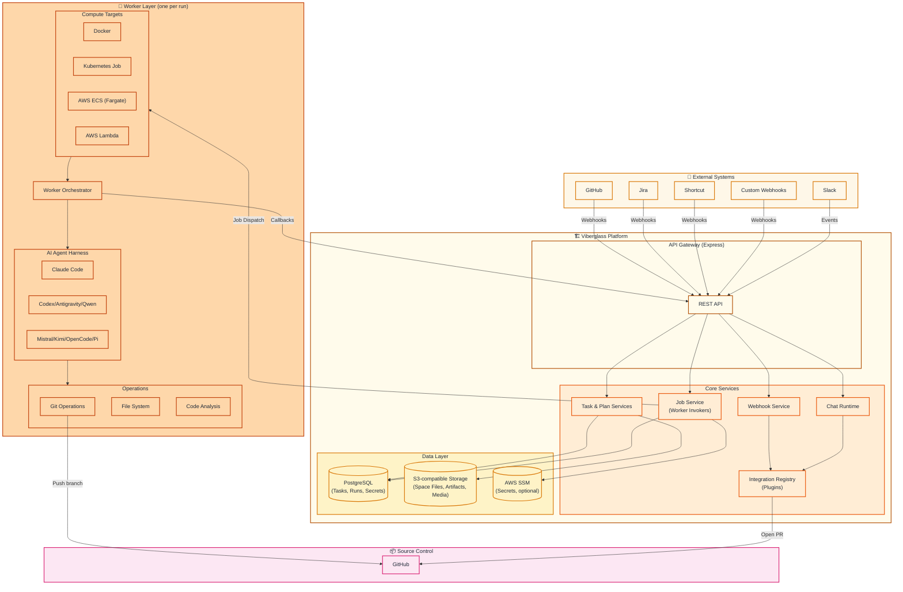
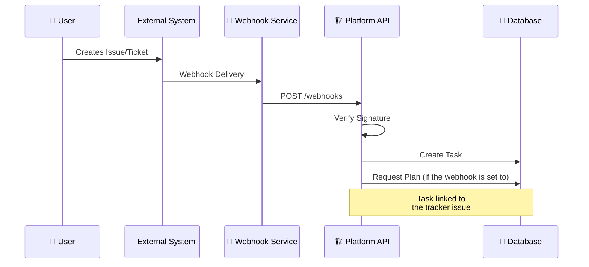
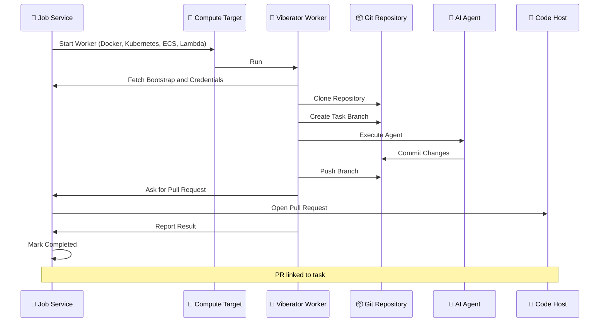
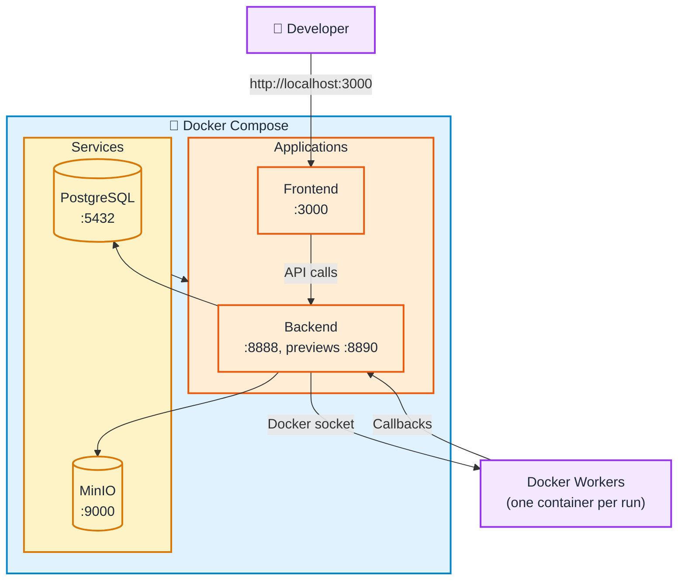
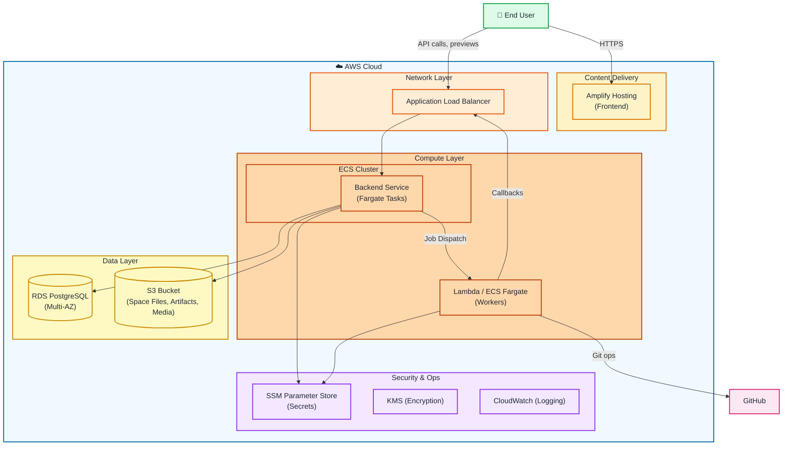

# Viberglass Architecture

This document provides a comprehensive overview of the Viberglass system architecture.

## Table of Contents

- [System Overview](#system-overview)
- [Architecture Diagram](#architecture-diagram)
- [Core Components](#core-components)
- [Data Flow](#data-flow)
- [Technology Stack](#technology-stack)
- [Deployment Architecture](#deployment-architecture)
- [Security](#security)
- [Scalability Considerations](#scalability-considerations)
- [Monitoring & Observability](#monitoring--observability)

## System Overview

Viberglass is a self-hosted workspace where people and coding agents work on the same tasks. The platform:

1. Takes tasks from the web app, Slack, issue trackers (GitHub Issues, Jira, Shortcut) and custom webhooks
2. Runs an agent for each step of a task (the plan, then the build) in a worker started for that run
3. Keeps one thread per task: people's messages, the agent's questions, plan revisions, runs and pull requests
4. Opens the pull request on the space's code host, or saves files and artifacts for a Files space, and mirrors activity back to Slack and the linked tracker issue

### Key Concepts

The product and the code use different names for some of these. The code name is in brackets.

- Space (`project`): A group of tasks, backed by a Git repository or by Files
- Task (`ticket`): A work item with its plan, code, people and one thread
- Run (`job`): One execution of an agent on a task, such as writing the plan
- Agent or runner (`clanker`): A configured agent: harness, model, compute and the secrets bound to it
- Viberator: The worker process (`apps/viberator`) that executes a run inside its container, Kubernetes Job, ECS task or Lambda invocation
- Artifact: A versioned deliverable an agent makes in a Files space, such as a document or a presentation
- Integration: A plugin connection to an external system: code host, tracker, webhooks or chat

## Architecture Diagram

## Core Components

### Platform Backend (`apps/platform-backend`)

Express.js REST API that serves as the central coordination point.

**Responsibilities:**
- REST API under `/api` for spaces, tasks, runs, agents, secrets and settings
- Webhook ingestion and processing, and the Slack bot (`/api/webhooks/slack`)
- Starting each run on its runner's compute and taking the worker's callbacks (progress, questions, results, pull request)
- Opening pull requests through the space's code host integration
- Files spaces: storing space files and artifact versions in S3-compatible storage
- Secret management and encryption
- The MCP endpoint (`/api/mcp`) for agents and MCP clients
- Artifact previews, served from a separate port and origin (`PREVIEW_PORT`, `PREVIEW_PUBLIC_URL`)

**Key Services:**
- `TicketWorkflowService`, `TicketPlanningService`, `TicketPhaseDocumentService`: task phases and plan documents
- `JobService`, `WorkerExecutionService`: run lifecycle and dispatch through a `WorkerInvoker` per compute target (`DockerInvoker`, `KubernetesInvoker`, `EcsInvoker`, `LambdaInvoker`)
- `WebhookService`: Webhook processing and validation
- `ChatBotRuntime`, `TaskChatMirror`: the Slack bot and the task threads it mirrors
- `SpaceFilesRunService`, `ArtifactService`: Files space snapshots and artifact versions
- `SecretService`, `SecretResolutionService`: secret storage and resolving the secrets bound to a runner
- `ClankerProvisioningService`: setting up a runner's compute (ECS task definitions, Lambda functions, Kubernetes checks)
- Sweepers (`HeartbeatSweeper`, `OrphanSweeper`, `KubernetesJobReconciler`, `PullRequestOutcomeSweeper`): stale runs, Kubernetes Job state and merged pull requests

### Platform Frontend (`apps/platform-frontend`)

React SPA (Vite) for user interaction.

**Responsibilities:**
- Home, Overview and space pages
- Task threads, plan review and comments
- Files and Artifacts pages for Files spaces, with artifact previews
- Run inspection: the agent's steps, tool calls, prompt, worker log and usage
- Workspace settings: agents, models, secrets, connections, members, notifications, API tokens and audit log
- First-run setup

**Key Features:**
- Live run progress
- Task forms with media upload
- Configuration screens contributed by integration plugins
- Agent readiness and health checks

### Viberator Worker (`apps/viberator`)

AI agent execution engine that processes jobs.

**Responsibilities:**
- Repository cloning and branch management, or for a Files space, restoring the space's files at the start of the run and saving them at the end
- AI agent harness execution
- Code analysis and modification
- Committing and pushing; the platform opens the pull request on the space's code host
- Relaying the agent's questions to the task and waiting for answers
- Progress reporting to platform

**Agent harnesses:** the ones `viberglass.plugins.json` lists. A default build has Claude Code, OpenAI Codex, Google Antigravity, Qwen CLI, Mistral Vibe, OpenCode, Kimi Code and Pi, plus a fake agent for tests.

### Other clients

- `packages/cli`: the `viberglass` CLI (`npm install -g viberglass`); `viberglass checkout` takes over a task's branch locally
- `packages/mcp-server`: the MCP server behind `/api/mcp`
- `apps/chrome-extension`: creates tasks from any page, with a screenshot, a recording and the page's context

### Harness and integration plugins

Harnesses (`packages/agents/`) and integrations (`packages/integrations/`) are plugin packages, and `viberglass.plugins.json` lists the ones a build includes. `npm run generate:plugins` registers them in the worker, the backend and the frontend; `npm run generate:catalog` and `npm run generate:dockerfiles` write the catalogs and the worker images from them. Nothing outside a plugin's package names it: the runner form, connection screen, webhooks, repositories, chat and sign-in all go through what each plugin declares. See [ADR 0015](adr/0015-harnesses-and-integrations-are-plugins.md), and to add one, [packages/agents/README.md](../packages/agents/README.md) or [packages/integrations/README.md](../packages/integrations/README.md).

### Infrastructure (`infra/`)

Pulumi stacks for AWS, a Helm chart for Kubernetes and the worker images.

**Stacks:**
1. **Base** (`infra/base`): VPC, KMS, CloudWatch logging
2. **Workers** (`infra/workers`): worker ECR repositories, Lambda worker, ECS Fargate cluster and task definition, worker roles
3. **Platform** (`infra/platform`): ECR, RDS, S3, backend on ECS behind an ALB, Amplify frontend, the preview origin, SES email

The Helm chart in `infra/kubernetes/chart` installs the backend, frontend and a migration Job on an existing cluster, with optional bundled PostgreSQL and MinIO; each run is a Kubernetes Job in a separate worker namespace. Worker Dockerfiles are in `infra/workers/docker`, most of them generated from the harness plugins.

## Data Flow

### Task Creation Flow (from a tracker or webhook)

1. User creates issue in GitHub/Jira/Shortcut
2. Webhook delivered to platform
3. Signature verified, payload validated, duplicate deliveries dropped
4. Task created in the space the webhook belongs to, linked to the issue
5. If the webhook is set to plan new issues, the task's agent is asked for a plan

Tasks created from the web app, Slack (`/viberglass`), the Chrome extension or the API skip the webhook steps.

### Job Execution Flow

1. Run status: `queued`
2. The backend starts a worker on the runner's compute target
3. Worker fetches its bootstrap payload and the secrets bound to the runner, authenticated with the run's callback token
4. Worker clones the repository and checks out the task branch
5. AI agent analyzes and modifies code, sending progress and questions to the platform
6. Changes committed and pushed
7. The platform opens the pull request through the space's code host
8. Run status: `completed` (or `failed`, `cancelled`)
9. Result posted to the task's thread, and from there to Slack and the linked issue

A plan run follows the same path without the push and pull request. In a Files space the worker restores the space's files instead of cloning, and saves them and any artifacts back to storage at the end.

## Technology Stack

### Backend

| Technology | Purpose |
|------------|---------|
| Node.js 20+ | Runtime |
| Express.js | Web framework |
| TypeScript | Type safety |
| Kysely | Type-safe SQL query builder |
| PostgreSQL | Primary database |
| AWS SSM | Optional secret storage (required when agents run on ECS) |
| S3-compatible storage (AWS S3, MinIO, others) | Space files, artifacts, media, plan documents, session archives |
| OpenTelemetry | Optional tracing |

### Frontend

| Technology | Purpose |
|------------|---------|
| Vite 6 | Build tool and dev server |
| React 19 | UI library |
| TypeScript | Type safety |
| Tailwind CSS | Styling |

### Infrastructure

| Technology | Purpose |
|------------|---------|
| Pulumi | Infrastructure as Code |
| Helm | Kubernetes installation |
| Docker / Docker Compose | Local development, single-server installs, worker containers |
| Kubernetes | Platform and worker Jobs |
| AWS ECS | Container orchestration |
| AWS Lambda | Serverless compute |
| AWS RDS | Managed PostgreSQL |
| AWS Amplify | Frontend hosting |

## Deployment Architecture

### Local Development

Optional compose profiles add Mailpit (`mail`) and Langfuse (`langfuse`); see [local-development.md](local-development.md). `docker-compose.prod.yml` runs the same backend, frontend and PostgreSQL from published images on one server, with Caddy for HTTPS.

### Kubernetes

The Helm chart runs the backend and frontend as Deployments, migrations as a Job per Helm revision, and each run as a Kubernetes Job in a separate worker namespace. The frontend's nginx proxies `/api` to the backend. Workers get no Kubernetes API token and no storage keys: they fetch their credentials and signed storage URLs from the backend with a callback token mounted from a per-run Secret. Bring PostgreSQL, S3-compatible storage, ingress and TLS, or use the bundled PostgreSQL and MinIO locally. See [kubernetes-deployment.md](kubernetes-deployment.md) and [local-kubernetes.md](local-kubernetes.md).

### Production (AWS)

## Security

### Authentication & Authorization

- Email and password sign-in with server-side sessions; API tokens for scripts, the CLI and MCP clients
- Workspace roles (admin, member, guest, viewer), open or private spaces, and per-task people decide who can see, comment, ask the agent and build
- Workers authenticate their callbacks with a per-run callback token
- Webhook signature verification (HMAC-SHA256 where the provider signs deliveries)
- Admin changes to secrets, agents, members and other settings are recorded in the audit log

### Data Protection

- **At Rest**: AES-256-GCM encryption for secrets and credentials stored in PostgreSQL (`SECRETS_ENCRYPTION_KEY`)
- **In Transit**: TLS at the ingress or load balancer (TLS 1.2 or newer on the AWS ALB)
- **Key Management**: AWS KMS for SSM parameters on AWS
- Artifact previews are served from a separate origin, so an artifact's scripts never share the app's origin or cookies

### Network Security

- VPC isolation for production workloads
- Security groups for fine-grained access control
- Private subnets for database and workers
- On Kubernetes, network policies limit worker egress; they need a NetworkPolicy-capable CNI

### Secret Management

- Workspace secrets: encrypted in PostgreSQL, or in AWS SSM Parameter Store with KMS encryption (SSM when agents run on ECS)
- Only the secrets bound to a runner reach its runs; Kubernetes workers fetch them from the backend at start instead of having them in the Job spec
- Worker-only credentials, such as a ChatGPT sign-in, are kept out of the agent's environment
- Never exposed in API responses; log output is redacted
- Deployment secrets: see [DEPLOYMENT_SECRETS.md](DEPLOYMENT_SECRETS.md)

## Scalability Considerations

### Horizontal Scaling

- Each run gets its own worker, so runs scale with the compute target: Docker on the host, Kubernetes Jobs within the worker namespace quota, ECS Fargate tasks or Lambda invocations
- The backend runs as a single instance (`backend.replicas: 1` on Kubernetes, one ECS task on AWS); sweepers and dispatch coordination run in that process
- Any number of runners can work on tasks at the same time

### Webhook Delivery

- Inbound deliveries are recorded and deduplicated
- A failed delivery can be retried from the recorded payload

## Monitoring & Observability

### Logging

- Structured JSON logging (Winston) with sensitive values redacted
- CloudWatch Logs on AWS
- Each run's worker log, Kubernetes Pod state and events are shown on the run

### Metrics

- Cost and token usage per run where the harness reports it
- Run records across the workspace under Settings → Run records

### Tracing

- Optional OpenTelemetry tracing from the backend through the worker and the agent (`OTEL_EXPORTER_OTLP_ENDPOINT`); see [telemetry-local.md](telemetry-local.md)

---

For more information, see:
- [README.md](../README.md) - Quick start and overview
- [CONTRIBUTING.md](../CONTRIBUTING.md) - Contribution guidelines
- [docs/DEPLOYMENT_SECRETS.md](DEPLOYMENT_SECRETS.md) - Deployment configuration
- [docs/guide/README.md](guide/README.md) - User and administrator guide
