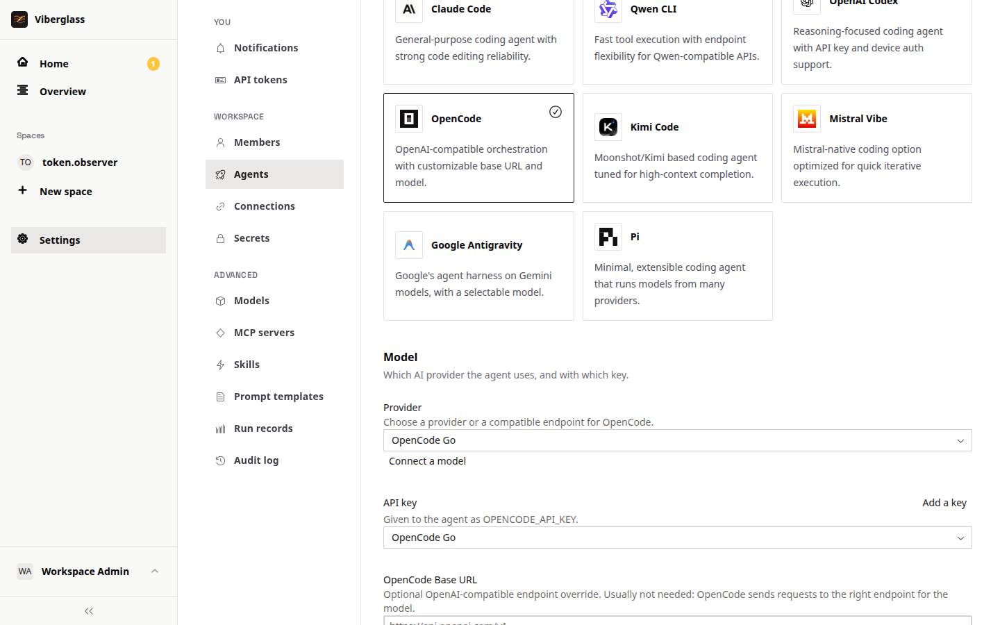

# Agents and models

A runner is a configured agent: which coding agent runs a task, with which model and key, on which compute. Setup creates a default runner; add more under Settings → Agents to offer other agents or models.

## Coding agents

Viberglass runs these coding agents, each in its own worker image:

| Agent | Models |
|---|---|
| Claude Code | Anthropic |
| OpenAI Codex | OpenAI, with an API key or a ChatGPT sign-in |
| Google Antigravity | Google Gemini |
| Qwen CLI | Alibaba Cloud Model Studio, Alibaba Coding Plan |
| Mistral Vibe | Mistral |
| Kimi Code | Kimi Code, Moonshot AI |
| DeepSeek Harness | DeepSeek |
| OpenCode | OpenCode Go, OpenRouter, DeepSeek, xAI, Groq, and workspace models |
| Pi | Anthropic, workspace models, and providers set in its `models.json` |

The agents on offer are the harness plugins listed in `viberglass.plugins.json` at the repository root, built into the backend and worker images. Adding or removing one means building your own images; see the [agent plugins README](https://github.com/Ilities/viberglass/blob/main/packages/agents/README.md).

## Create a runner

Open Settings → Agents and choose New agent.

1. Name it after what you'll know it by, such as the account or team it belongs to.
2. Pick the agent.
3. Pick the provider and key, or a custom endpoint. Choose a key you've already added, or add one here; keys are shared across runners. The list only offers what the chosen agent can use. Codex also asks what to sign in with: an API key or a ChatGPT account.
4. Set the model. With a workspace model, pick it from the endpoint's list. OpenCode, Kimi and Antigravity have a model field, filled in with the provider's default; type another model name to change it. The other agents run their own default model.
5. Create it.

Under Advanced:

- Compute: where its runs go. Docker on this host is the default on a Docker install. Kubernetes, ECS and Lambda are offered when the installation is set up for them, with their own resource and time limits. On Docker, Image picks Published image, the default, which pulls the agent's worker image, or Build from source, which builds it from the source checkout the backend runs from, as in the Docker quick start. Build from source is only offered when the backend has that checkout, which the published backend image doesn't. To run your own worker images there, build them from a checkout of the repository with `./infra/workers/scripts/build-workers.sh all`, push them with `push-workers.sh all` to the registry in `VIBERATOR_WORKER_REGISTRY` (leave it empty to use images on the Docker host), and pick Published image. A runner saved to build from source on a backend without the checkout won't start; switch it to Published image.
- Instructions: an AGENTS.md file with instructions for every run. OpenCode and Pi can also take their own config file, `opencode.json` or `models.json`, for example to add a model provider.
- Tools: MCP servers the agent can call, and skills it can load.
- Extra environment variables, each from a secret.

## Can a runner take tasks?

A runner's page shows by its name whether it can take tasks, separately from its compute status:

- Ready: it can take tasks.
- Needs a model key: no key is attached.
- Needs a login: a Codex runner that signs in with ChatGPT hasn't been signed in yet.
- Not running: its compute isn't started.
- Key rejected: the provider refused the key.

Only ready runners are picked when a task doesn't name an agent. The page also shows the last run's outcome. The first task run checks the key and model for real.

### ChatGPT sign-in for Codex

A Codex runner can use a ChatGPT account instead of an API key: choose ChatGPT account under Sign in with in the runner form. Save and start the runner, then choose Connect under ChatGPT account on its page and follow the device sign-in. The login is stored encrypted for that runner and kept up to date by its runs.

## Which agent takes a task

When someone asks without naming an agent, the task's next request goes to the first of these that can run:

1. The agent already working on the task.
2. The space's default agent, if the space has picked one.
3. The workspace's default agent.
4. The first ready runner.

The line above a task's suggested actions shows which one and why. People can pick another agent by mentioning it with @ in the thread.

To give a space its own default agent, open the space's Settings tab → Task defaults and choose one under Default agent. Its maintainers and workspace admins can change it. A space whose default can't run, for example because its key is missing, falls back to the workspace's default; if the space's default agent is deleted, the space goes back to using the workspace's default.

## Connected models

Any OpenAI- or Anthropic-compatible API can serve as a model: a provider such as OVH AI Endpoints or z.ai, or a server you run yourself, such as vLLM, LM Studio or Ollama. Every agent except Google Antigravity can use it. In the runner form, connected and deployed models are listed under Workspace models.

Add one under Settings → Models with Connect a model, or with Connect a model in the runner form. Either way, fill in:

- Name and Base URL. For OpenAI formats include the API prefix, such as `/v1`; for Anthropic Messages leave it out, as Anthropic clients add it.
- API format: Pi, Qwen CLI, Kimi Code and Mistral Vibe take all three. OpenCode takes OpenAI Chat Completions, Codex takes OpenAI Responses, and Claude Code takes Anthropic Messages.
- Authentication: a bearer token, a custom header, or none, with the key kept as a shared secret.
- Extra headers that aren't secret, as JSON.
- May need time to wake up, for endpoints that scale to zero. Runs then wait, up to 15 minutes, for the endpoint to answer before the agent starts.

Viberglass lists the endpoint's models from its `/models` route. If the endpoint doesn't have one, type the model IDs in. The Connected models list shows which runners use each model; one an agent uses can't be removed.

Endpoints can also be set up in first-run setup with Custom endpoint. The runner's page says when it sends its key to a custom endpoint.

## Deployed models (experimental)

Viberglass can run an open-weight model on a rented GPU for you, on Verda. The model is served by vLLM and appears as an endpoint runners can use.

1. Add a Verda account under Settings → Secrets → Cloud accounts, or from the deploy dialog. It needs the Cloud API client ID and secret, and the account's inference API key. A Hugging Face token is optional, for gated models.
2. Open Settings → Models and, under Deployed models, choose Deploy a model.
3. Pick a model from the vLLM Recipes list, with tested settings for the GPUs it lists, or any Hugging Face model.
4. Pick the GPU, check the serving arguments, and name it. Runners pick the model by this name.

For any Hugging Face model, the dialog checks the size of the model's weight files and won't deploy it on a GPU too small to hold them. A model that fits on paper can still need more room for its context; if it fails to start, lower `--max-model-len` or pick a bigger GPU. Prefer a quantized build when the GPU is tight: for example, `Qwen/Qwen3.8-27B` needs about 54 GB at full precision, but `Qwen/Qwen3.8-27B-FP8` is 31 GB and fits a 48 GB L40S. Take the tool-call parser from the model's vLLM recipe or model card (for Qwen3.8, `--tool-call-parser qwen3_xml --reasoning-parser qwen3`); with the wrong one, the model's tool calls aren't understood.

Each deployment has a mode:

- Scale to zero: runs only while agents use it. The first run after a quiet spell waits while the model starts; the first start also downloads the model.
- Keep warm: one GPU always on, with no start-up wait, billed every hour.
- Stop: nothing runs, and runs using it fail until it's started again.

The list shows each deployment's state (such as Idle · scaled to zero, Waking or Running), its GPU and price while running, and the runners that use it. Delete removes it from Verda; it can take a minute. The Verda account needs a positive balance to create deployments.

A cold start takes several minutes: waiting for a free GPU, pulling the vLLM image and loading the weights. A run that needs the model waits up to 15 minutes and reports how long it has waited. A deployment still waking after 20 minutes is shown as failed: its container is almost always crashing and restarting, often because the model doesn't fit the GPU. Check its logs in the Verda console and delete it, since the GPU is billed while it restarts.
