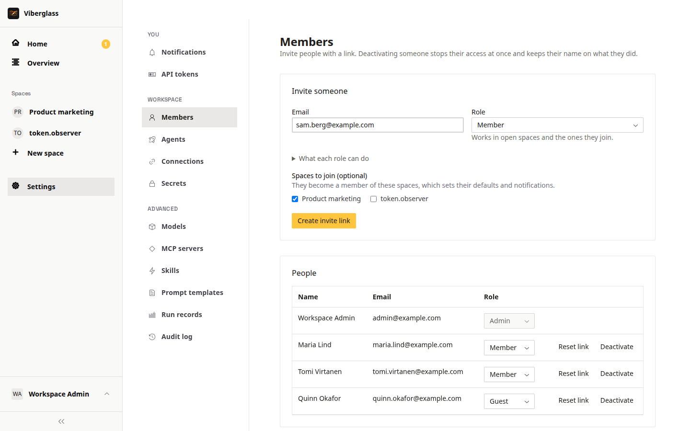

# People and access

Who can see and do what: workspace roles, spaces and their members, invites, and taking people out. Workspace admins manage people under Settings → Members; space maintainers manage their spaces.

## Workspace roles

Everyone has one workspace role.

- Admin: everything, including agents, connections, secrets and members. Admins see every space and maintain all of them.
- Member: sees open spaces, creates spaces and tasks, comments and asks agents; asks for code on tasks they're on, or in spaces they maintain.
- Guest: only the spaces they're invited to. Comments, and asks the agent, including to build, on tasks they're on. Can't create spaces or tasks.
- Viewer: read-only. Sees every open space and task, but can't create, comment or ask the agent anything. Viewers land on Overview.

The full comparison is in [Getting started](../user/getting-started.md#what-your-role-lets-you-do), and under "What each role can do" on the Members page. The server enforces it as well as the screens.

Being on a task as its owner, a reviewer or a watcher is what lets a member or guest ask for code there. Pausing, taking over and handing back are for the task's owner, the space's maintainers and admins.

## Inviting people

1. Open Settings → Members and go to Invite someone.
2. Enter their email and pick their workspace role.
3. Pick the spaces they join. A guest must have at least one; they'll see only those.
4. Choose Create invite link.

Use Copy link and send it to them. With email set up, it's emailed too. The person opens it, enters their name and a password, and joins. Pending invites are listed until they're used; Revoke cancels one.

## Passwords

People can't reset their own password yet. On Settings → Members, Reset link gives a link to send them for setting a new password.

## Removing access

Deactivate on Settings → Members stops someone signing in. Their history stays on the tasks they worked on.

## Spaces

A space holds the tasks for one product or repository. Members and admins create spaces with New space in the sidebar.

In a space's Settings tab:

- General: the space's name, and Private space. Open spaces are visible to every member and viewer, and membership sets defaults and notifications. A private space is visible only to its members and admins. General also shows the space's backing, Git repository or Files, and archives or deletes the space.
- Members: the people in the space, each with a space role, and Add someone. Maintainers manage the space's settings, members and defaults, and can steer its tasks. Members belong to it.
- Task defaults: the space's default agent (see [Which agent takes a task](agents-and-models.md#which-agent-takes-a-task)); the default owner of new tasks, whoever creates a task unless you pick someone; default reviewers, added to every new task; and Unanswered questions, which reminds people about the agent's unanswered questions after a while.

## Auditing

Settings → Audit log records changes to the workspace's plumbing and people, with who made them. Settings → Run records lists every agent run, with its agent, model, cost and tokens, result and pull request. Admins can also export the records as NDJSON from the API (`GET /api/run-manifests/export`).
