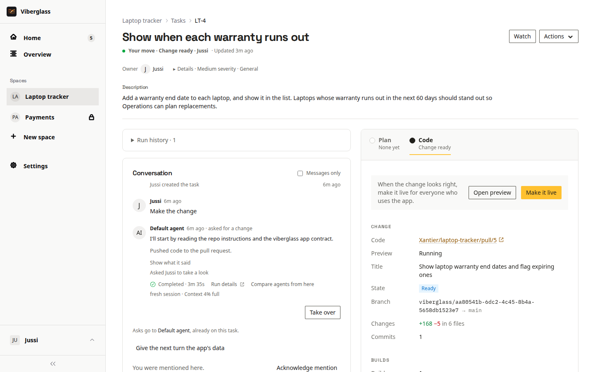
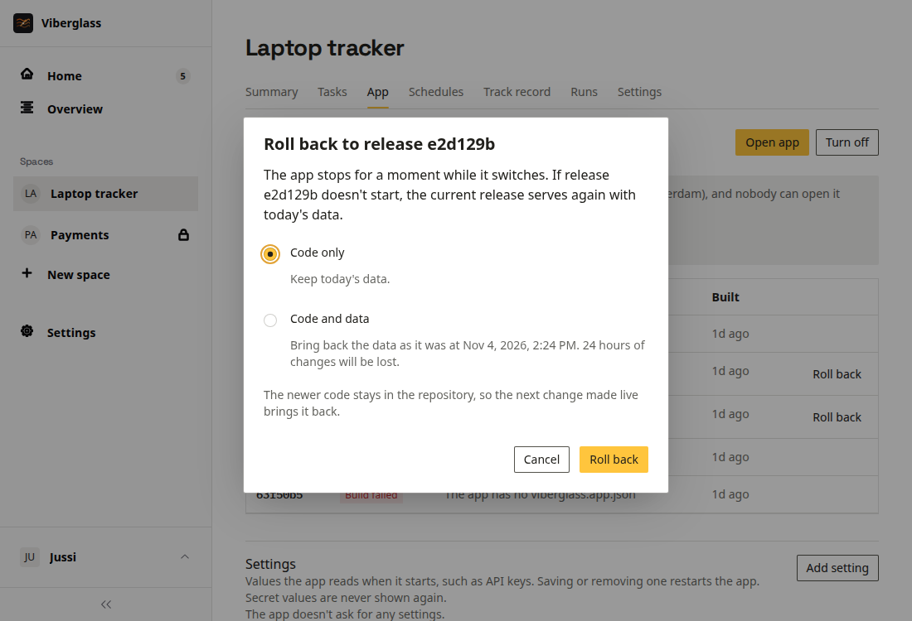

# Apps

An App space builds one internal app for your team, such as an equipment tracker or an approval list, and Viberglass runs it. You ask for the app and for changes to it in tasks, try each change on a preview, and make it live when it looks right. Nobody in the space deals with git or servers: Viberglass keeps the app's code in a private repository, builds it, backs up its data and decides who can open it.

App spaces are offered when an admin has set them up; see [Apps](../admin/apps.md) in the admin guide.

## App spaces

A space is backed by a Git repository, by Files, or by an App. Members and admins create an App space with New space: give it a name and choose App under Space backing. Viberglass creates a private repository for its code in the workspace's App home.

The space's name becomes the app's address, such as `laptop-tracker.apps.example.com`. It can use letters, numbers, spaces and hyphens, up to 63 characters, and can't start with "preview". Renaming the space moves the app to the new address.

An App space has the same tabs as a Git space, plus App, after Tasks. In its settings, the Repository page is under Advanced.

## Asking for the app and for changes

Write a task describing the app or the change, the way you would explain it to a colleague, and ask the agent to make it: choose Make the change, or ask in the thread. The agent asks what it needs to know in the task's thread, and you can ask for a plan first, as in any space. See [Tasks](tasks.md) and [Plans and reviews](plans-and-reviews.md).

The agent knows it's building a Viberglass app and follows the [app contract](#what-an-app-is). When it's done, the task shows its change under Code, in a panel called Change, as Ready. The situation reads "Change ready".

## Trying a change

Try it, in the Change panel, starts a preview: the change running on its own address, `preview-<id>.<apps domain>`, with a fresh copy of the live app's data. Open preview opens it in a new tab once it's running. Click through it and ask for anything else in the thread. Nothing done in a preview reaches the live app, and its copy of the data is thrown away with it.

- Anyone who can post on the task can start a preview. Viewers can open one but not start it.
- Previews are for people who can see the space. People who only have the app through its access list can't open them.
- A preview of an older version shows Running an older version, and Try the latest builds the newest one.
- Previews turn off at night and after a few hours without being opened. Try it turns one on again, with fresh data.

## Making a change live

Once the change's latest version has been tried, Make it live appears next to Open preview. The task's owner, the space's maintainers and workspace admins can make a change live; others see who can.

Make it live merges the change into the app's repository. Viberglass builds a release from it, backs up the app's data, stops the running release and starts the new one. The app is unavailable for a moment while it switches. If the new release doesn't answer its health check, the previous one starts again with the data from before, and the task's thread says why.

The task closes as "Done · made live by" whoever made it live, and the thread records "The change is live" once it's serving. In a task started from Slack, the thread gets "It's live." with a link to the app. If a release fails, the task's requester and owner are told.

A change merged straight into the repository's main branch on GitHub goes live the same way, within about a minute.

## The App page

The space's App tab shows whether the app is Running, Starting, Stopping, Off or Not running, with its current release, Open app, and the releases. Each release has a status: Live, Building, Build failed, Didn't go live, Rolled back, Was live, Ready or Removed, and Reason says why a build failed or a release didn't go live.

Maintainers also see:

- Turn off and Turn on. While the app is off, people who open it see a page naming the space's maintainers.
- Roll back and Make live on earlier releases.
- Back up now, which copies the app's data. A running app stops for a moment while it's copied and starts again.
- Settings and Who can open it, below.
- Logs, the app's recent output.

### Rolling back

Roll back, on a release that was live before, offers two choices:

- Code only: the earlier release runs with today's data.
- Code and data: the data goes back to how it was when that release was replaced. The dialog says how many hours of changes that loses. It's offered while a backup from then is kept.

The newer code stays in the repository, so the next change made live brings it back. The releases newer than the one you rolled back to are marked Rolled back, and a maintainer can make one of them live again with Make live.

Viberglass keeps the releases and data backups needed for this for a while: by default the last five releases that went live, and backups from the last 30 days. A backup a schedule restores is kept as long as that schedule exists. Older releases show as Removed.

## Who can open an app

Each app asks for Viberglass sign-in. Everyone who can see the App space can open its app: admins, and the space's members, or every member and viewer when the space is open. Maintainers can give it to others under Who can open it, on the App page:

- Enter an email and choose Add. Someone with an account goes straight on the list.
- Someone without an account gets an invite as an app user of this app. Copy the link and send it to them; with email set up, it's emailed too. The link works once, for 7 days.
- Remove and Cancel invite take someone off. It takes effect at the app within a few seconds.

App users sign in to Viberglass and land on Your apps, the list of apps they can open, with nothing else: no spaces, tasks or settings. Anyone can open that list at `/apps`. See [People and access](../admin/people-and-access.md#who-can-open-an-app).

## Settings and secrets

Some apps need values such as an API key for another service or a webhook address. Maintainers set them under Settings on the App page. The app reads each as an environment variable when it starts, and saving or removing one restarts it.

- Add setting asks for a name, such as `SLACK_WEBHOOK_URL`, and a value. Settings the app declares are listed already, with Not set and Set until they have a value, and the App page warns while one is missing.
- Secret keeps the value in the secret store. It's never shown again, and agents never see it.
- A plain setting also goes to previews. A secret goes to previews only with Also for previews; leave that off for keys that act on the real world, such as payments.

Names starting with `VIBERGLASS_`, `AWS_` or `LITESTREAM_`, and `PORT`, `HOME`, `PATH`, `NODE_OPTIONS` and `APP_DATABASE_PATH`, are set by Viberglass and can't be settings.

## Turning the app off at night

An app that nobody uses at night can be off then. The App page offers to add two schedules, off at 22:00 and on at 07:00 in your time zone; Not now hides the offer. Under the space's Schedules tab, maintainers can change those or add their own with Turn the app on or Turn the app off as what the schedule does. See [Schedules](schedules.md).

## Resetting the data on a schedule

A demo or training app can go back to the same data every hour, or every night. Set up the data in the app, choose Back up now on the App page, then add a schedule under the space's Schedules tab with Restore app data as what it does and that backup under Backup. Backups taken when releases went live are listed too. Each run stops the app, puts the backup's data in place of the live data and starts the app again; the App page shows Restoring the app's data from a backup while it does. Whatever people changed since the backup is lost. See [Schedules](schedules.md#app-schedules).

## Giving the agent the app's data

The agent doesn't see the app's data, only its code. When a change needs it, for example to find out why some records look wrong, a maintainer can choose Give the next turn the app's data in the task's thread. Viberglass copies the live data, and the agent's next turn on that task can read the copy. What it reads also goes to the agent's model provider. The copy is deleted once that turn ends, or after a day if no turn takes it, and Withdraw cancels it before then. The agent never changes the live data; fixing data is a change like any other.

## Bringing in an existing repository

A Git space's repository can become an app. The space's connection has to be able to merge into it, which needs the same write access an agent's push does, and its pull requests have to go to the repository's own main branch. In the space's Settings, under General, choose Make this an App space. Tasks, members, schedules and the repository stay; from then on, changes go live when someone makes them live, which merges them into the repository.

- If the space's name doesn't fit an app's address, the dialog asks for a new one.
- Choose what data the app starts with: a SQLite file you upload (up to 512 MB), no data, or its data from before if the space hosted an app earlier.
- If the repository doesn't follow the app contract yet, a task, "Make this repository a Viberglass app", asks the space's default agent to make it fit with as few changes as possible. The app has nothing to serve until that change is made live.

## Stopping hosting an app

When an app outgrows what Viberglass runs, such as needing Postgres or several servers, choose Stop hosting the app in the space's Settings, under General. The space carries on as a Git space on the same repository, with its tasks, members and history.

The app stops for good. Its previews, access list, settings and secrets, and its app schedules are removed. People who could only open this app keep their accounts, with nothing to open. A last copy of its data is kept, for 30 days unless an admin changed that: Download the app's last data gives it as a SQLite file, and making the space an App space again can start from it.

## Archiving and deleting

Archiving an App space turns its app off for good, with a last copy of its data, and nobody can open it. Deleting the space deletes the app with its releases, data and backups. Its repository is archived on GitHub, not deleted: it becomes read-only, with a description saying Viberglass archived it, and its owner can unarchive it.

## What an app is

Every app has the same shape, which is what lets Viberglass build, run, back up and roll back any of them:

- A Node.js app, built and started with the commands in its `viberglass.app.json`.
- One SQLite database, copied continuously to the workspace's object storage. Nothing else it writes to disk is kept.
- One instance, at its own address, behind Viberglass sign-in. The app gets the signed-in person's id, email and name from Viberglass and has no sign-in of its own. Everyone who can open it can do everything in it.
- It can reach services on the internet, but not Viberglass, its database or other apps.

Apps can't yet use Postgres or another database, run more than one instance, run scheduled jobs, receive webhooks, send email, be public, or have roles inside them. Software that needs those belongs in a Git space with its own deployment.
