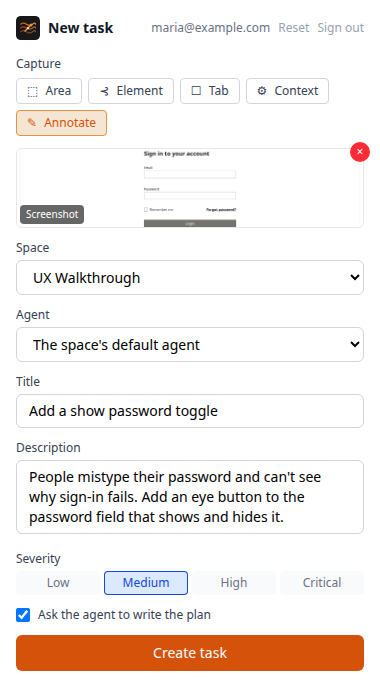

# Chrome extension

The Chrome extension creates a task from the page you're on, with a screenshot, an annotated area or element, a screen recording, and the page's details, console errors and failed requests attached. It can ask an agent to write the plan straight away.

## Install it

The extension isn't in the Chrome Web Store; you load it unpacked.

1. Download `viberglass-chrome-extension-<version>.zip` from the [latest release](https://github.com/Ilities/viberglass/releases/latest) and unzip it. To build it yourself instead, run `npm install` and `npm run build -w @viberglass/chrome-extension` in the Viberglass repository; the extension is in `apps/chrome-extension/dist`.
2. Open `chrome://extensions` and turn on Developer mode.
3. Choose Load unpacked and pick the unzipped folder, or `apps/chrome-extension/dist`.

Chrome keeps an unpacked extension until you remove it. To update it, replace the folder's contents with the new version and choose the reload button on the extension's card.

In the extension's settings, enter your workspace's address and its API address. On a Docker install these are `http://localhost:3000` and `http://localhost:8888`. On Kubernetes and most other installs, both are your workspace's address. Then sign in with your Viberglass email and password.

## Create a task

1. On the page you want to talk about, open the extension.
2. Capture what shows it: the visible tab, a selected area, or a clicked element. You can annotate the screenshot, or record the screen.
3. When you open it, the extension collects the page's address, browser and window size, and the console errors, uncaught errors and failed requests since the page loaded. Choose Context to collect them again.
4. Pick the space, write a title and description, and set the severity.
5. Leave Ask the agent to write the plan on to have the agent start on the plan as soon as the task exists. When the workspace has more than one agent you can pick which one; otherwise the space's default agent writes it.
6. Create the task. The extension links to it in Viberglass.

## What the task gets

The task shows a Captured by the browser extension section under its description: the page's address, the browser, the window size, and how many console errors and failed requests there were. Open the count to see them.

A failed request is one that got an error status, such as `POST /api/billing/checkout → 402`, or that the browser couldn't complete, such as an image or font that failed to load. Each shows its method, address and status or the browser's error. Console errors include warnings and errors the page didn't catch. The extension keeps the latest 50 of each, from when the page last loaded.

The agent gets the same details with the task, along with the screenshot.
