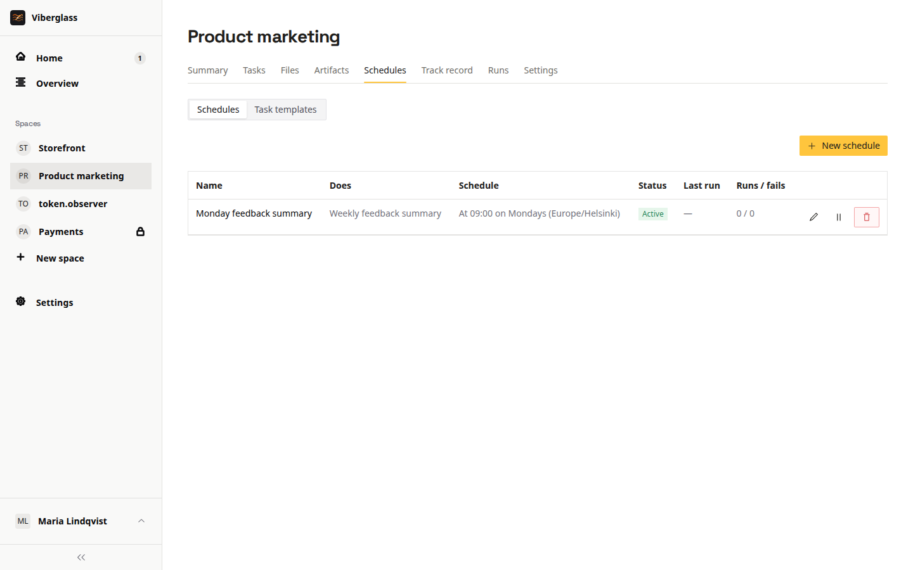

# Schedules

Schedules run agent work on a timer, such as updating dependencies every Monday or checking for security patches each night. Each space has its own task templates and schedules.

Open a space and choose its Schedules tab. Members and admins create, edit, pause and delete templates and schedules. Viewers see them without the buttons to change them, and guests don't see Schedules. The page has two tabs, Schedules and Task templates.

## Task templates

A task template is the work a schedule runs. Under Task templates, choose New template and fill in:

- Name, and an optional description.
- Agent: the agent that does the work. The list shows the agents that can run, the same ones you can ask on a task.
- Task instructions: what the agent should do each time.
- Credentials: extra secrets the run needs, on top of the runner's own. Only admins choose them; members see which ones a template uses.

A template can be used by several schedules.

## Schedules

1. Under Schedules, choose New schedule.
2. Give it a name and pick the task template. The template's instructions are filled in, and you can adjust them for this schedule.
3. Choose the schedule type. Interval runs every so many minutes, hours, days or weeks. At set times runs hourly, daily, on weekdays, weekly or monthly at the time you pick. Its Custom option takes a six-field cron expression (second, minute, hour, day of month, month, day of week), such as `0 0 9 * * 1` for 09:00 every Monday. Fields take ranges and lists, such as `1-5` for Monday to Friday or `1,3,5`. The form says in words when it will run.
4. Pick the timezone and choose Create schedule.

Each schedule shows whether it's Active or Paused and when it last ran. Runs / fails counts the runs that have ended and how many of those failed; a run that was cancelled counts as a run but not as a failure. Pause stops it until you Resume it. The runs are listed under the space's Runs.

## App schedules

In an App space, maintainers can also schedule the space's app. A schedule's What it does is Run a task template, Turn the app on, Turn the app off or Restore app data; the app actions need no template, and what a schedule does can't be changed on an existing one. A common pair turns the app off at night and on in the morning, and the App page offers to add exactly that. Only maintainers create, change, pause or delete app schedules; everyone who can see the space sees them. See [Apps](apps.md#turning-the-app-off-at-night).

Restore app data puts the app's data back to a backup each time it runs, such as every hour for a demo or training app. Pick the backup under Backup; the list shows when each was taken, the release that was serving and why it was taken. To restore data you set up yourself, take a backup with Back up now on the App page first. Each run stops the app, replaces its data with the backup and starts it again on the same release; an app that's off stays off with the restored data. Everything changed since the backup is lost, and no copy of it is kept. The schedule shows the backup it restores, and that backup is kept for as long as the schedule exists. If a restore fails, the run fails and the schedule is paused. See [Apps](apps.md#resetting-the-data-on-a-schedule).

## What a scheduled run does

In a space with a repository, a scheduled run works in the repository; if the agent changes code, it opens a pull request.

In a Files space there's no repository and no pull request. The run starts from the space's files as last saved, and saves them when it ends, for later runs and the space's tasks. Runs in the same space take turns: if another run is working on the files, a scheduled run waits for it to save them first. A run that fails or is cancelled partway still saves what it had, marked as partial.

To keep something the run makes, such as a weekly report, ask for it in the task instructions. The agent declares it, and each run that does adds a new artifact to the space's Artifacts page. A run's page shows what it saved and the artifacts it made. Runners on AWS Lambda can't work in Files spaces; choose an agent that runs on Docker, ECS or Kubernetes.

