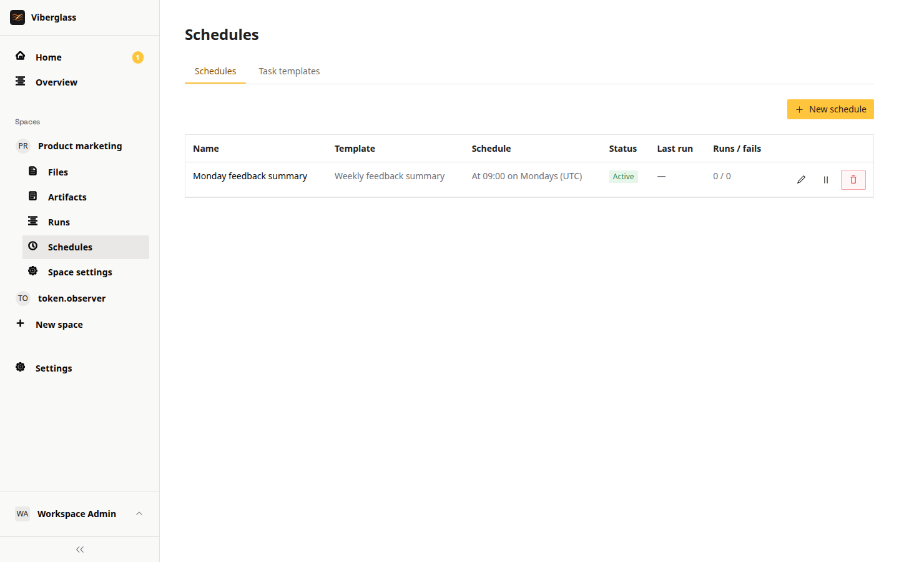

# Schedules

Schedules run agent work on a timer, such as updating dependencies every Monday or checking for security patches each night. Each space has its own task templates and schedules.

Open a space and choose Schedules in the sidebar. Members and admins create, edit, pause and delete templates and schedules; guests and viewers don't see Schedules. The page has two tabs, Schedules and Task templates.

## Task templates

A task template is the work a schedule runs. Under Task templates, choose New template and fill in:

- Name, and an optional description.
- Agent: the agent that does the work. The list shows the agents that can run, the same ones you can ask on a task.
- Task instructions: what the agent should do each time.
- Credentials: extra secrets the run needs, on top of the runner's own. Only admins choose them; members see which ones a template uses.

A template can be used by several schedules.

## Schedules

1. Under Schedules, choose New schedule.
2. Give it a name and pick the task template. The template's instructions are filled in, and you can adjust them for this schedule.
3. Choose the schedule type. Interval runs every so many minutes, hours, days or weeks. At set times runs hourly, daily, weekly or monthly at the time you pick. Its Custom option takes a six-field cron expression (second, minute, hour, day of month, month, day of week), such as `0 0 9 * * 1` for 09:00 every Monday. The form says in words when it will run.
4. Pick the timezone and choose Create schedule.

Each schedule shows whether it's Active or Paused and when it last ran. Runs / fails counts the runs that have ended and how many of those failed; a run that was cancelled counts as a run but not as a failure. Pause stops it until you Resume it. The runs are listed under the space's Runs.

## What a scheduled run does

In a space with a repository, a scheduled run works in the repository; if the agent changes code, it opens a pull request.

In a Files space there's no repository and no pull request. The run starts from the space's files as last saved, and saves them when it ends, for later runs and the space's tasks. Runs in the same space take turns: if another run is working on the files, a scheduled run waits for it to save them first. A run that fails or is cancelled partway still saves what it had, marked as partial.

To keep something the run makes, such as a weekly report, ask for it in the task instructions. The agent declares it, and each run that does adds a new artifact to the space's Artifacts page. A run's page shows what it saved and the artifacts it made. Runners on AWS Lambda can't work in Files spaces; choose an agent that runs on Docker, ECS or Kubernetes.

