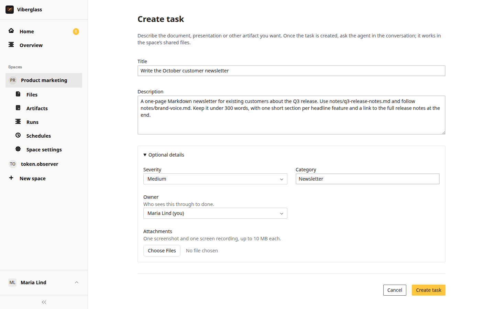

# Tasks

A task is something someone wants done, and the place where people and the agent work on it together. This page covers creating tasks from the web, Slack and issue trackers, and reading a task's page.

## Creating a task on the web

1. On Home, choose Ask for something. If you're in more than one space, pick the space from its menu. You can also open a space and choose Create task.
2. Give it a title that states the outcome, such as "Change the welcome text to Welcome to Acme".
3. In the description, write what you want, any context the agent wouldn't find in the code, and how you'll know it's right. You don't need to know which files are involved.
4. Optionally set the severity and category, and attach a screenshot or a screen recording.
5. Choose Create task.

The task opens. You're its owner unless the space sets a different default owner. Nothing runs yet: choose Write the plan to ask the agent for a plan, or Build it if the change is small and clear. See [Plans and reviews](plans-and-reviews.md). In a Files space you ask for an artifact instead of a build; see [Files and artifacts](files-and-artifacts.md).

A good description is concrete. "Make the welcome text say Welcome to Acme, without punctuation. Keep the existing function signature. Add a test for the exact text." gives the agent and your reviewers the same target.

## Other ways tasks start

- From Slack, with `/viberglass`. The task gets a Slack thread that stays in step with it. See [Slack](slack.md).
- From an issue tracker. A space can take issues from GitHub Issues, Jira or Shortcut: every issue, or only those with certain labels. A space takes none until someone sets it up, and a GitHub issue only goes to spaces that use its repository. Those issues become tasks linked to them. Comments on the issue appear in the task's thread, mentioning the bot there asks the agent, and Viberglass posts the plan, its questions, the pull request and when it's done back to the issue. Closing the issue marks the task done, and reopening it opens the task again. Which issues a space takes is under Space settings → Incoming issues; see [Issue trackers](../admin/issue-trackers.md).
- From a custom webhook, for tools that can send an HTTP request.
- From the [Chrome extension](chrome-extension.md), with a screenshot and the page's details attached.
- From an MCP client, with the `task_create` tool. See [MCP server](mcp.md).
- On a schedule. See [Schedules](schedules.md).

## The task page

At the top: the space and the task's key, the title, where the task stands, and Watch and Actions. Choose Watch to follow the task, or Stop watching to leave it. Below that:

- People: one line with the owner, reviewers and watchers. Details next to it opens the key, severity, category, the linked issue if there is one, the created date, and the people on the task.
- Description: what was asked for. Show more opens a long one.
- Plan and Code: the task's artifacts, as tabs. Each shows where it stands, such as None yet, Agent working, Written or Pull request open. Either can be asked for at any time. A task in a Files space has Artifact and Plan here instead: Artifact previews the task's artifact, with Open and Download, and picks between them when there's more than one.
- The thread: the conversation, newest at the bottom, with the composer and suggested next steps under it.

On a phone, switch between Conversation and Artifacts at the top. Write a reply takes you to the composer.

## Writing in the thread

Write a message and choose Send. A plain message is for people: the agent reads the whole thread the next time someone asks it for something, but a message alone doesn't start it.

The suggested actions under the composer, such as Write the plan or Build it, ask the agent in one step. If you've written something in the composer, choosing one sends your message as the request instead of the suggestion's own words.

To show what you mean, paste or drop images into the composer, or choose Attach images: up to four per message, PNG, JPEG, GIF or WebP, 10 MB each. They show under your message, and the agent turn that answers it gets them as files to open. A later turn doesn't get them again, so attach an image again if you want the agent to look at it once more. Send now and interrupt sends words only, so it isn't offered while images are attached.

Type @ to mention someone. Pick a person to ask for their attention; it shows on their Home. Pick an agent to ask that agent for something; your message is the request. The line above the suggested actions says which agent your next request goes to, and whether it picks up its earlier conversation or starts fresh from the task and its documents.

If the agent is working, the button says Send after this turn: your message waits until the agent finishes its turn.

## Each agent turn

Each time the agent works, the thread shows what it set out to do and a result line, such as "Wrote the plan". Show what it said opens its full reply. A run that failed says why, who can fix it, and offers Try again when trying again could help.

Under the turn, a small line says whether the agent picked up its earlier conversation (resumed session) or started over (fresh session), and how full its context is, such as "Context 40% full", or "12k tokens in context" when the agent doesn't report its context size.

Members and admins also see Live log and Cancel run while the agent works, and Run details afterwards. Run details opens the record of the run: what the agent did step by step, its tool calls, the prompt it got, the worker's log, and the model, time and cost where the agent reports them.

## The Actions menu

- Edit details: change the title, description and other details.
- View screenshots: open attached media.
- Copy link: copy the task's address.
- Copy to another space: start a task with the same title and description in another space, for work that needs that space's repository. Both threads link to each other; the plan and runs stay with the original. Members and admins have it.
- Finish task: close the task by hand. Its history stays, and nothing is merged. Reopen task opens it again. In a Files space this is Mark done.
- Archive: take the task out of the space's working lists while keeping its record.
- Delete task: remove it, for those allowed to.

What you see in the menu depends on your role and your place on the task.
